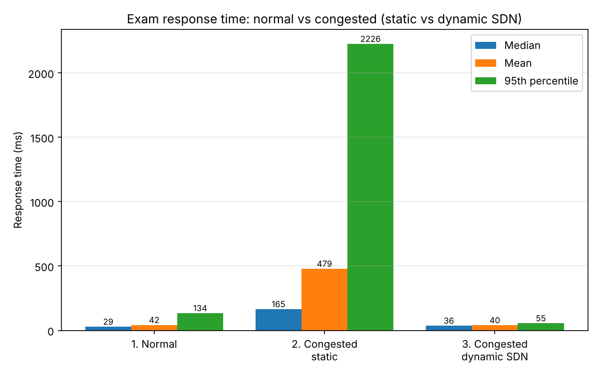

# Online Examination Network over SDN

**Computer Networks — Jackfruit Mini Project 18 · PES University**

A multi-client online examination application built with low-level Python TCP sockets, deployed in a Mininet network controlled by a Ryu SDN controller (OpenFlow 1.3). When background UDP traffic congests the primary link, the controller detects it from switch port statistics and reroutes **only the exam traffic (TCP port 5000)** through an alternate path, then returns it once the congestion clears.

---

## Contents

1. [Team](#1-team)
2. [What the project does](#2-what-the-project-does)
3. [Architecture](#3-architecture)
4. [Repository layout](#4-repository-layout)
5. [Environment and setup](#5-environment-and-setup)
6. [Link capacity calibration (important)](#6-link-capacity-calibration-important)
7. [Running the system](#7-running-the-system)
8. [Reproducing the three experiments](#8-reproducing-the-three-experiments)
9. [Test cases](#9-test-cases)
10. [Results](#10-results)
11. [Limitations and honest notes](#11-limitations-and-honest-notes)
12. [Troubleshooting](#12-troubleshooting)
13. [Rubric mapping](#13-rubric-mapping)

---

## 1. Team

| Member | Role | Owns |
|---|---|---|
| Joshitha Kornu | Application development | TCP exam server and client, protocol, question bank, results |
| Jeevitha | Network infrastructure and SDN | Mininet topology, Ryu controller, static/dynamic routing |
| Karthik K R | Integration, traffic and evaluation | Running the app in Mininet, UDP congestion, experiments, analysis, documentation |

---

## 2. What the project does

**Application (TCP sockets)**
- Exam server handles many students concurrently (one thread per student).
- Students log in and wait in a lobby. The exam starts automatically when *N* students have joined (or manually with `START`).
- The server delivers 12 multiple-choice questions one at a time, receives answers, enforces **one common deadline**, scores each student, and saves results atomically to a JSON file.
- Handles disconnects, timeouts, invalid messages and invalid answers, each with its own result status.
- Automated client mode (`--auto`) for repeatable experiments, with per-question timing written to CSV.

**Network (SDN)**
- Mininet topology with three OpenFlow 1.3 switches in a triangle: a primary path and an alternate path.
- Ryu controller installs all forwarding rules proactively (IPv4 and ARP), so the triangle loop never floods.
- Every 2 s the controller polls the S1→S2 port byte counter and computes link utilisation.
- **Dynamic mode:** if utilisation > 75%, exam TCP/5000 traffic is moved to S1→S3→S2. If it falls below 50%, the traffic is moved back. The gap between the two thresholds, plus a 6 s minimum dwell time, prevents route flapping.
- **Static mode:** the same rules, but never rerouted. This is the baseline for comparison.
- Background UDP traffic always stays on the primary link.

---

## 3. Architecture

### 3.1 Topology

```text
      h1          h2          h3         h_bad
   10.0.0.1    10.0.0.2    10.0.0.3    10.0.0.5
       \  p1       | p2       | p3       / p4
        +--------------------------------+
        |               S1               |
        +---------------+----------------+
                p5      |        p6
        PRIMARY  /                \  ALTERNATE
        10 Mbps /                  \ 10 Mbps
        5 ms   /                    \ 5 ms
        p2    /                      \ p1
         +------+    p3        p2  +------+
         |  S2  |------------------|  S3  |
         +--+---+   ALTERNATE      +------+
            | p1    10 Mbps, 5 ms
         s_server
         10.0.0.4  (TCP 5000)
```

(`pN` = OpenFlow port number on that switch.)

### 3.2 Addressing and ports

| Node | IP | Role |
|---|---|---|
| h1, h2, h3 | 10.0.0.1–10.0.0.3 | Student clients |
| s_server | 10.0.0.4 | Exam server, TCP 5000 |
| h_bad | 10.0.0.5 | Background UDP generator (iPerf3) |

| Switch | DPID | Ports |
|---|---|---|
| S1 | 1 | 1=h1, 2=h2, 3=h3, 4=h_bad, **5=S2 (primary)**, **6=S3 (alternate)** |
| S2 | 2 | 1=s_server, 2=S1, 3=S3 |
| S3 | 3 | 1=S1, 2=S2 |

The port numbers come from the link creation order in `topology.py`. They are checked automatically at startup (`check_ports`) and were verified with `net` and `ovs-ofctl show s1`.

### 3.3 Link parameters (`TCLink`)

| Link | Bandwidth | Delay | Queue |
|---|---|---|---|
| Host access links | 100 Mbps | 1 ms | 1000 pkts |
| Primary S1–S2 | 10 Mbps | 5 ms | 50 pkts |
| Alternate S1–S3, S3–S2 | 10 Mbps | 5 ms | 100 pkts |

### 3.4 Controller flow rules

| Rules | Priority | Match | Where |
|---|---|---|---|
| Base forwarding | 100 | IPv4 by destination IP, and ARP by target IP | S1, S2 (primary tree) |
| Exam forward | 300 | TCP, src = student, dst = 10.0.0.4, dst port 5000 | S1, S2 (and S3 when rerouted) |
| Exam reverse | 300 | TCP, src = 10.0.0.4, src port 5000, dst = student | S1, S2 (and S3 when rerouted) |

Rerouting changes only the exam rules: S1 forward port 5→6 and S2 reverse port 2→3. The S3 rules are installed first (downstream before upstream), with an OpenFlow barrier after each switch, so no packet reaches a switch before its rule exists. On return, the primary rules are restored first and the S3 rules are removed afterwards. UDP never matches the exam rules, so it stays on S1–S2.

### 3.5 Application protocol

TCP port 5000, **newline-delimited JSON** (one JSON object per line). The receiver buffers bytes until a newline arrives, because TCP is a byte stream and does not preserve message boundaries. Message types: `welcome`, `login`, `waiting`, `exam_started`, `question`, `answer`, `result`, `rejected`. Full table: [`README_socket_part.md`](README_socket_part.md).

JSON was chosen over the originally specified pipe-delimited ASCII format because named fields are easier to parse and extend. The framing principle (newline-terminated messages) is the same.

---

## 4. Repository layout

```text
.
├── README.md                  # this file
├── README_socket_part.md      # application protocol and client/server usage
├── examination_server.py      # TCP exam server (Member 1)
├── examination_client.py      # TCP exam client, interactive or --auto (Member 1)
├── questions.json             # 12-question bank
├── topology.py                # final Mininet topology (Member 2)
├── controllor.py              # Ryu controller, static/dynamic (Member 2)
├── analyze_results.py         # computes metrics + graph from results/ (Member 3)
└── results/
    ├── summary_results.csv
    ├── response_time_comparison.png
    ├── normal/    h1-3.csv/.log, server.log, server_results.txt
    ├── static/    h1-3.csv/.log, server.log, server_results.txt, udp.txt,
    │              iperf_server.log, ryu_static.log, flow_table_proof.txt
    └── dynamic/   h1-3.csv/.log, server.log, server_results.txt, udp.txt,
                   iperf_server.log, ryu_dynamic.log, flow_table_proof.txt
```

---

## 5. Environment and setup

Tested on:

| Component | Version |
|---|---|
| OS | Kali Linux 2026.1 (VM) |
| Python | 3.11 |
| Mininet | 2.3.0 |
| Open vSwitch | 4.0.0 |
| Ryu | 4.34 (installed from source, `faucetsdn/ryu`) in a venv at `~/CN-Project/.venv` |
| iPerf3 | 3.22 |
| matplotlib | optional, only for the graph |

Ryu installation that worked (inside the venv): clone `faucetsdn/ryu`, install `setuptools==67.8.0` and `pbr`, then run `pip install --no-build-isolation .` in the Ryu folder.

```bash
git clone https://github.com/karthikkr-237/CN-Project-Online-Examination-SDN.git
cd CN-Project-Online-Examination-SDN
```

Mininet, OVS and iPerf3 run with the system `python3` under `sudo`. Ryu runs from the venv.

---

## 6. Link capacity calibration (important)

`controllor.py` line 20 sets the capacity used to compute utilisation:

```python
LINK_CAPACITY_MBPS = 5.0
```

**Why 5.0 and not 10.0:** in our VM, the link configured as 10 Mbps carried only about 5 Mbps in practice. Mininet's traffic shaping runs slower inside a VM. Measured on the primary path from h_bad to s_server:

| Test | Sender | Receiver | Loss |
|---|---|---|---|
| TCP (`iperf3 -t 10`) | 5.24 Mbps | 4.60 Mbps | — |
| UDP 5 Mbps | 5.00 Mbps | 4.72 Mbps | 4.8% |
| UDP 9 Mbps | 9.00 Mbps | 5.71 Mbps | 36% |

With `10.0`, a 9 Mbps flood only showed 40–63% utilisation and the 75% trigger could never fire. With the measured capacity, `5.0`, the controller works as designed. The 75%/50% thresholds were not changed.

**On a different machine, measure first and set the value to match.** With topology and controller running:

```text
mininet> s_server iperf3 -s > /tmp/iperf_server.log 2>&1 &
mininet> h_bad iperf3 -c 10.0.0.4 -t 10
```

Use the TCP receiver bitrate (rounded) as `LINK_CAPACITY_MBPS`.

---

## 7. Running the system

Use two terminals, both in the repository folder. **Order matters:** `sudo mn -c` can kill a running Ryu process, so clean up first.

**Terminal 1: cleanup, then controller**

```bash
sudo mn -c
source ~/CN-Project/.venv/bin/activate
EXAM_MODE=dynamic ryu-manager --ofp-tcp-listen-port 6653 controllor.py 2>&1 | tee ryu_dynamic.log
#   or, for the baseline:
EXAM_MODE=static  ryu-manager --ofp-tcp-listen-port 6653 controllor.py 2>&1 | tee ryu_static.log
```

Expected: `Controller started in DYNAMIC mode` (or STATIC), then `Switch S1/S2/S3 connected`, `Initial flows installed`, and a `[STATS]` line every 2 s.

**Terminal 2: topology**

```bash
sudo python3 topology.py
```

Expected: the switch port map, then `Port map matches the specification.` Wait about 3 s, then:

```text
mininet> pingall
```

Expected: `0% dropped (20/20 received)`.

**Useful inspection commands (inside Mininet)**

```text
mininet> sh ovs-ofctl -O OpenFlow13 dump-flows s1 | grep tp_dst=5000
mininet> sh ovs-ofctl -O OpenFlow13 dump-flows s3
```

---

## 8. Reproducing the three experiments

Each scenario writes to its own folder. The client and server **append** to their output files, so always use a fresh folder per run.

> **Tips learned during testing**
> - Start the iPerf3 server with its output redirected to a file. Otherwise its per-second output floods the Mininet prompt and delays the next commands.
> - Enter every command exactly once. Starting a client twice creates a duplicate session.
> - The Mininet CLI replaces host names with IPs, so `--name h1` is recorded as `10.0.0.1` in the logs.

### Scenario 1: Normal (no congestion)

Controller in dynamic mode. With no congestion it stays on the primary path.

```text
mininet> sh mkdir -p results/normal
mininet> s_server python3 -u examination_server.py --auto-start 3 --duration 120 --results results/normal/server_results.txt > results/normal/server.log 2>&1 &
mininet> h1 python3 -u examination_client.py 10.0.0.4 --auto --name h1 --think-time 2 --csv results/normal/h1.csv > results/normal/h1.log 2>&1 &
mininet> h2 python3 -u examination_client.py 10.0.0.4 --auto --name h2 --think-time 2 --csv results/normal/h2.csv > results/normal/h2.log 2>&1 &
mininet> h3 python3 -u examination_client.py 10.0.0.4 --auto --name h3 --think-time 2 --csv results/normal/h3.csv > results/normal/h3.log 2>&1 &
```

After about 45 s: `sh tail -10 results/normal/server.log` should show 3 results with `status=completed`.

### Scenario 2: Congested + static routing

Restart Ryu with `EXAM_MODE=static` (see section 7), then:

```text
mininet> sh mkdir -p results/static
mininet> s_server iperf3 -s > results/static/iperf_server.log 2>&1 &
mininet> h_bad iperf3 -c 10.0.0.4 -u -b 9M -t 90 --logfile results/static/udp.txt &
```

Wait about 5 s. Ryu shows utilisation ≥ 75% but stays `state=PRIMARY`. Then start the server and the three clients with the same commands as Scenario 1, replacing `normal` with `static`. About 30 s later, check that S1 still shows `output:5` and S3 is empty.

### Scenario 3: Congested + dynamic SDN rerouting

Ryu with `EXAM_MODE=dynamic`, then:

```text
mininet> sh mkdir -p results/dynamic
mininet> s_server iperf3 -s > results/dynamic/iperf_server.log 2>&1 &
mininet> h_bad iperf3 -c 10.0.0.4 -u -b 9M -t 90 --logfile results/dynamic/udp.txt &
```

Wait until Ryu prints `[SDN] PRIMARY -> ALTERNATE`, then start the server and clients (replace `normal` with `dynamic`). About 30 s later, while the flood is still running, check that S1 shows `output:6` and S3 has exam rules with `n_packets > 0`. After the flood ends, Ryu prints `[SDN] ALTERNATE -> PRIMARY` and the S3 rules are removed.

### Analysis

```bash
sudo chown -R $USER:$USER results      # results/ is created by Mininet as root
python3 analyze_results.py
```

This prints the summary table and writes `results/summary_results.csv` and `results/response_time_comparison.png`.

---

## 9. Test cases

All results below were observed on 17 Nov 2026 on the environment in section 5.

| # | Test | Expected | Observed |
|---|---|---|---|
| T1 | Topology structure | 5 hosts on the correct switches, port map as in 3.2 | ✅ Matched (`net`, `ovs-ofctl show s1`, DPID 1) |
| T2 | Connectivity with custom controller | `pingall` 0% loss | ✅ 0% dropped (20/20) |
| T3 | Link capacity | Measure the real primary-link throughput | ✅ TCP ≈ 4.6–5.2 Mbps → capacity set to 5.0 (section 6) |
| T4 | Exam lifecycle, normal conditions | 3 students complete 12 questions, results saved | ✅ 3/3 `completed`; exam rules counted packets on S1 port 5 |
| T5 | Congestion detection | Utilisation > 75% triggers reroute | ✅ First sample under flood read 122–135% → `PRIMARY -> ALTERNATE` |
| T6 | Selective rerouting of exam traffic | S1 `output:6`; S3 rules carry exam traffic both ways; UDP stays on primary | ✅ See `results/dynamic/flow_table_proof.txt`; UDP still lost ~34% on S1–S2 |
| T7 | Recovery | Utilisation < 50% returns traffic to primary; S3 rules removed | ✅ `recovery threshold crossed (0.0% < 50%)` → `ALTERNATE -> PRIMARY`; S3 empty |
| T8 | Hysteresis / no flapping | No route change while utilisation is 50–75% | ✅ Readings of 64.5% and 73.3% under the flood did not cause a return |
| T9 | Static baseline | Never reroutes, even under congestion | ✅ S1 `output:5`, S3 empty, no `[SDN]` events in `ryu_static.log` |
| T10 | Exam under congestion (static) | Exam still completes, slower | ✅ 3/3 `completed`; P95 response 2.2 s |

---

## 10. Results

**Metric definitions**
- **Response time** = time from sending an answer to receiving the next question (or the final result), measured by the client. It includes network delay, TCP retransmissions and server processing. It does **not** include student think time.
- **Fairness** = Jain's index over each student's service rate, where service rate = 1 ÷ that student's mean response time. 1.0 means every student was served equally.
- **UDP loss** = iPerf3 receiver-side datagram loss for the background flood.

### 10.1 Summary (one run per scenario, 12 questions per student)

| Scenario | Students | Samples | Mean | Median | P95 | Max | Jain | UDP loss |
|---|---:|---:|---:|---:|---:|---:|---:|---:|
| 1. Normal | 3 | 36 | 41.9 ms | 28.6 ms | 134.1 ms | 154.1 ms | 0.997 | — |
| 2. Congested, static | 3 | 36 | **478.8 ms** | 165.2 ms | **2225.7 ms** | **3151.2 ms** | **0.918** | 36% |
| 3. Congested, dynamic SDN | 2 | 24 | **39.7 ms** | 36.3 ms | **55.3 ms** | 94.9 ms | **0.994** | 34% |

Per-student mean response time:

| Scenario | h1 | h2 | h3 |
|---|---:|---:|---:|
| Normal | 43.5 ms | 43.5 ms | 38.6 ms |
| Congested, static | 327.6 ms | **721.3 ms** | 387.4 ms |
| Congested, dynamic | 36.5 ms | 42.9 ms | (excluded, see section 11) |



### 10.2 Interpretation

- **Congestion hurts the exam under static routing.** With exam traffic sharing the flooded primary link, P95 response time rose from 134 ms to about 2.2 s, and the worst answer took 3.2 s. TCP losses and retransmissions on the full queue cause these spikes.
- **Dynamic rerouting removes the impact.** Under the same flood, rerouted exam traffic had a P95 of 55 ms, at or below the normal baseline. The alternate path adds one switch and one extra 5 ms link, but it avoids the congested queue.
- **Fairness.** Under static congestion, students were served unequally (h2 waited about twice as long as h1, Jain 0.918). With rerouting, fairness stayed near 1.0 (0.994).
- **Only exam traffic moved.** The UDP flood kept losing about 35% of its packets on S1–S2 in both congested scenarios, as intended: the controller moves exam traffic away from the congestion rather than removing the congestion.
- **Reaction time.** The controller rerouted on the first 2 s statistics sample after the flood began, and returned on the first sample after it ended. Detection delay is therefore bounded by the polling interval (≤ 2 s) plus rule installation. Precise timestamps were not logged.

---

## 11. Limitations and honest notes

- **Single run per scenario.** The numbers come from one run each (24–36 response samples per scenario). Repeated runs would give confidence intervals.
- **Capacity calibration.** `LINK_CAPACITY_MBPS` is set to the measured 5 Mbps rather than the configured 10 Mbps (section 6). Utilisation readings above 100% appear because throughput sometimes exceeds the calibrated value.
- **Scenario 3 uses two students.** In the recorded dynamic run, the h3 client was accidentally started twice, so its CSV mixes two sessions and is excluded. The duplicate is visible in `results/dynamic/server_results.txt` (two records for 10.0.0.3).
- **Duplicate logins are not rejected** by the server (the original `ALREADY_LOGGED_IN` behaviour is not implemented).
- **Socket–SDN integration is traffic-driven.** The controller identifies exam traffic by TCP port 5000 and reacts to measured link load. The server's optional `--controller-url` notification is **not used**: the controller has no HTTP endpoint for it.
- **Robustness paths** (client disconnect, deadline timeout, invalid message) are implemented in the server code but were not separately recorded as experiments.
- **No QoS.** The project deliberately uses path rerouting, not queues or priority scheduling.

---

## 12. Troubleshooting

| Symptom | Cause / fix |
|---|---|
| Ryu stops after `sudo mn -c` | Known in this setup: always run `sudo mn -c` **before** starting Ryu |
| `pingall` fails | Check Ryu shows all three switches connected and `Initial flows installed`; wait about 3 s after start |
| Reroute never triggers | Utilisation stays below 75%: re-measure capacity (section 6) and set `LINK_CAPACITY_MBPS` |
| `iperf3: unable to connect / connection refused` | The iPerf3 server isn't running: `s_server iperf3 -s > /tmp/iperf_server.log 2>&1 &` |
| Mininet prompt freezes during a test | A background command is printing to the terminal: redirect its output to a file |
| `Address already in use` on port 5000 | An old exam server is still running: `s_server pkill -f examination_server.py` |

---

## 13. Rubric mapping

| Rubric item | Where it is covered |
|---|---|
| Problem understanding and architecture | Sections 2, 3 |
| TCP socket implementation | `examination_server.py`, `examination_client.py`, `README_socket_part.md`, 3.5 |
| Mininet + SDN implementation | `topology.py`, `controllor.py`, 3.1–3.4, tests T1–T2 |
| Socket–SDN integration | Exam app running over controller-installed TCP/5000 rules, T4–T6 |
| Initial testing and demo | Section 7, tests T1–T4 |
| Complete application functionality | Section 2, T4, T10 |
| Dynamic SDN functionality | Monitoring + rerouting + recovery + hysteresis, T5–T8 |
| Challenging scenario / robustness | 9 Mbps UDP congestion, T5–T10 |
| Performance evaluation and comparison | Section 10: static baseline vs dynamic, response time, fairness, loss |
| Documentation, demo, viva | This README, `results/`, section 8 for reproduction |
